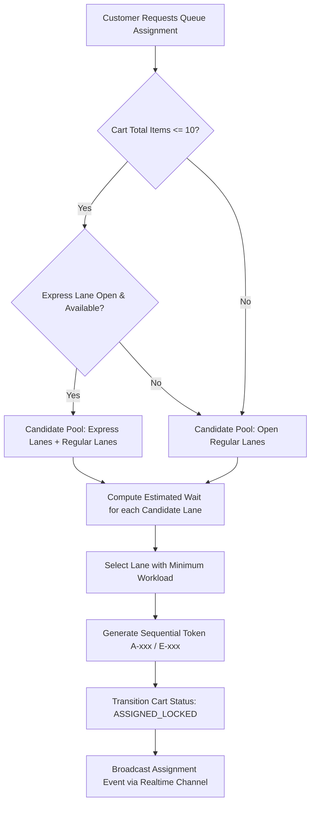

# ZeroWait Queue Allocation Algorithm

## 1. Core Objectives
1. **Minimize Customer Wait Times**: Dynamically assign carts to the lane that will clear them fastest.
2. **Express Lane Segregation**: Route shoppers with 10 or fewer items to dedicated express counters to prevent large trolley starvation.
3. **Load Balancing Across Counters**: Prevent bottlenecks by continuously factoring in current lane queue depth, cashier scan rate, and items-per-basket.
4. **Cart Lock on Assignment**: When a cart is assigned to a queue, its status shifts to `ASSIGNED_LOCKED`. No new items can be added or removed while moving to the checkout counter, preventing checkout fraud.

---

## 2. Workload Formula

For each active checkout lane $L_i$ where `status = 'OPEN'`:

$$\text{Workload}(L_i) = W_{\text{base}}(L_i) + \sum_{c \in Q(L_i)} \left( N_{\text{items}}(c) \times t_{\text{scan}} + t_{\text{payment}} \right)$$

Where:
- $W_{\text{base}}(L_i)$: Current remaining time for the cart actively being scanned at $L_i$.
- $Q(L_i)$: Set of carts queued ahead in lane $L_i$.
- $N_{\text{items}}(c)$: Item count for cart $c$.
- $t_{\text{scan}}$: Average cashier scanning speed (standard constant: 4 seconds / item).
- $t_{\text{payment}}$: Payment & packaging handoff duration (standard constant: 35 seconds).

---

## 3. Allocation Decision Rules

### Express Lane Rules
- If $N_{\text{items}} \le 10$, candidate pool defaults to Express lanes. If express lanes have an unusually high queue depth ($\text{depth} \ge 4$), the algorithm evaluates regular lanes and redirects if estimated wait is at least 30% lower.
- If $N_{\text{items}} > 10$, Express lanes are strictly excluded (`max_items_limit` constraint).

### Self-Checkout Rules
- Only assigned if customer selects preference or if designated for basket shoppers under 15 items.

---

## 4. State Synchronization

- **On Assignment**:
  - `cart_sessions.status` = `'ASSIGNED_LOCKED'`
  - `cart_sessions.assigned_lane_id` = selected lane UUID
  - `cart_sessions.locked_at` = current timestamp
  - `lane_assignments` row created with `assignment_status` = `'QUEUED'`
- **On Cashier Call**:
  - `lane_assignments.assignment_status` = `'SERVING'`
  - `lane_assignments.called_at` = current timestamp
  - `cart_sessions.status` = `'AT_CHECKOUT'`
- **On Completed Payment**:
  - `lane_assignments.assignment_status` = `'COMPLETED'`
  - `lane_assignments.served_at` = current timestamp
  - `cart_sessions.status` = `'PAID'`
